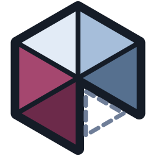

# Mesh Optimizer

Mesh Optimizer is a non-destructive plugin for [NDMF](https://github.com/bdunderscore/ndmf) that reduces a VRChat avatar's meshes at build time. It decimates them, collapsing edges while every surface stays within a chosen distance of the original in every pose and expression the avatar can take, and it removes triangles that are guaranteed to stay hidden under clothing. It works on NDMF's build clone, so nothing in the scene or the project is modified.

## Install

### Requirements

- Unity 2022.3
- VRChat Avatars SDK
- NDMF 1.14.8 or newer

The package depends on Unity's Burst, Collections and Mathematics packages at the versions the VRChat SDK already requires, so installing it does not upgrade anything else in your project.

### Install from a git URL

1. In Unity, open **Window > Package Manager**.
2. Select **+ > Add package from git URL**.
3. Enter `https://github.com/Ryan6-VRC/vrc-mesh-optimizer.git`.
4. Select **Add**.

The Package Manager does not resolve the VRChat-side dependencies, so the VRChat Avatars SDK and NDMF must already be in the project. Every VCC or ALCOM avatar project has them.

A VCC or ALCOM listing is not available yet.

## Quick start

1. Select the root of your avatar.
2. Choose **Add Component > Mesh Optimizer > Mesh Optimizer**.
3. Leave the target at **Tolerance** and the preset at **Standard (1 mm)** for a first build.
4. If you want the body under a garment cut away, add that garment's renderer to **Always-on renderers**.
5. Build or upload the avatar as usual.

Mesh Optimizer runs on every NDMF build and upload. It reads the component on the build clone and removes it before upload. The meshes it writes exist only on the clone.

A **target** is the rule that decides when decimation stops. A tolerance target bounds how far the optimized surface may move from the original; the triangle count is whatever that leaves. A triangle-count target tries to fit the whole avatar within a fixed number of triangles, and stops short, reporting the target unmet, if reaching it would move a surface further than **Max error**.

An **always-on renderer** is one that no animation ever hides or fades. Only renderers you list here can hide triangles on other meshes. If you list a renderer that can be hidden, the geometry removed under it shows as a hole whenever it is off. The list is manual on purpose: the optimizer does not try to work out from your animators which renderers are safe.

## Settings

| Setting | Default | What it does |
| --- | --- | --- |
| **Component** | | |
| Decimate | On | Collapses edges to lower the triangle count while the surface stays within the target wherever the avatar bends or animates. |
| Remove hidden triangles | On | Removes triangles that an always-on renderer moving on the same bones covers from every direction within a 75° cone around the surface normal. |
| Target | Tolerance | Whether the optimizer stops at a surface-deviation tolerance or pursues a triangle count. |
| Preset | Standard (1 mm) | A starting tolerance. Fine is 0.5 mm, Standard 1 mm, Medium 2 mm, Coarse 3 mm. Any other value is Custom. |
| Tolerance (mm) | 1 | The largest surface deviation allowed when the target is a tolerance. |
| Triangle count | 70,000 | The triangle count for the whole avatar when the target is a count. 70,000 is the PC line between the Poor and Very Poor performance ranks. |
| Max error (mm) | 5 | The largest surface deviation a triangle count may cost. If the count needs more, the build stops there and reports the target unmet. 0 removes the limit. |
| Always-on renderers | Empty | Renderers that are never hidden. Only these may hide triangles on other meshes. |
| Outlines show the inside | Off | Keeps a covered triangle when its material's outline draws the back side and only the front is covered. Enable it for garments whose inside is visible through the outline. |
| Face keeps at least | 50% | The share of the lip-sync face renderer's triangles kept whatever the target. |
| Lock fingers | On | Keeps every vertex on a finger, found through the humanoid mapping. |
| Finger weight | 0.01 | A vertex with at least this skin weight on a finger bone counts as a finger vertex. Lower locks more of the hand. |
| **Per material** | | |
| Material overrides | None | A material whose automatic occlusion decision needs changing. |
| Treat as | Automatic | Automatic reads the render queue and render type first, then samples texture alpha when needed. Opaque always hides what is behind it. See-through never does. |
| **Per renderer** | | |
| Renderer settings | None | A renderer that needs settings of its own. |
| Exclude from decimation | Off | Leaves this renderer's triangles alone. Its hidden triangles can still be removed. |
| Protection | 1 | How much detail this renderer keeps. Its error counts this many times over against the target, so 1 is neutral and higher keeps more. The lowest accepted value is 0.1. |

**Occlusion** is one surface blocking another from view. The per-material settings tell the hidden-triangle pass whether a surface counts as opaque cover. **Analyze renderer materials** in the inspector shows how Automatic classifies every material on the always-on renderers, and adds no overrides.

Leave material overrides empty unless Automatic gets a material wrong. Set **See-through** on a surface with gaps an opaque shader does not describe, such as lace, mesh fabric or cut-outs. Set **Opaque** on a solid surface that a transparent render queue or texture alpha makes Automatic treat as see-through.

An outline never counts as cover. **Outlines show the inside** only decides whether geometry under an outlined material must also be covered from behind.

## What the report tells you

After each build, Mesh Optimizer writes a summary to the Unity Console: triangles before and after, how many hidden triangles were removed and how many decimation removed, whether a triangle-count target was met or the tolerance used, the error level reached, and the time taken.

Anything that needs your attention appears in NDMF's Error Report window: an unmet triangle target, a target stopped by Max error, an always-on entry that is not under the avatar, a skipped mesh, a See-through material override that matched nothing, and any failure during processing, with the full exception also written to the Console.

Failures are contained. A renderer that fails is reported while the others are still optimized, and the avatar still builds. One that fails while its mesh is read or written is left unchanged; one that fails during decimation keeps its hidden-triangle removals. If hidden-triangle detection fails, decimation still runs. If the pass fails before anything is applied, the avatar is left as it was.

The report also explains why a triangle-count target could not be reached (excluded renderers, the face floor, locked finger vertices, skipped meshes, clearance between clothing layers), and names triangles kept for a reason you may not expect: bones an animation can grow from zero scale, materials that render fur, outlined back sides when **Outlines show the inside** is on, and hidden triangles whose cover decimation removed.

## Preview

Enable **Preview decimation** in the avatar's inspector to see the decimated meshes in the Scene view while editing. The Mesh Optimizer toggle in NDMF's preview menu hides and restores the previews of avatars already chosen there; it does not start one.

The first preview processes every mesh on the avatar and can take a few seconds. The result is kept, so switching the preview off and on, changing the target or changing a renderer's protection updates quickly. A change to a mesh, a material, a renderer or the component prepares the avatar again.

The preview composes with the NDMF preview filters that run before it, such as a Modular Avatar Shape Changer: each renderer is read as those filters left it, so geometry they delete stays deleted.

The inspector shows the estimated triangle count before and after decimation and the error level reached. The counts are estimated from the avatar descriptor; the build report has the exact values. If the avatar root has no descriptor, the preview treats every shape key as animated.

The preview shows decimation only. Hidden triangles are removed at build. The preview turns off when a scene opens or Play mode starts.

## How it works

For each mesh, Mesh Optimizer records a sequence of edge collapses and the error each one introduces. It then chooses how far along those sequences to go across the avatar. A tolerance accepts every collapse within that error. A triangle count spends the available triangles across renderers at a common error level, weighted by protection and bounded by the face floor, the finger lock and Max error.

The error is a quadric error metric over the rest shape, every shape-key frame an animation can reach, UV coordinates and vertex normals, with a skin-weight term that resists collapses across a joint. Open edges carry a boundary constraint. Every collapse is checked for topology, for flips in every configuration, and for clearance: the gap between a layer of clothing and its nearest other layer, of which each layer keeps its share, so the two cannot meet.

Hidden-triangle removal samples each triangle's vertices and interior points, casts rays in a cone around the surface normal, and accepts cover only from opaque faces on always-on renderers that ride the same bones. It checks the avatar at rest and in every relevant shape-key configuration, checks both sides where a material renders its back, and rechecks after removing hidden faces that were themselves cover, so every triangle removed stays covered by geometry that remains.

The optimizer runs in NDMF's **Optimizing** phase, after the avatar's other tools have assembled it on the build clone.

Building the same avatar with the same package commit writes the same meshes on one machine with Burst on. Different machines' CPUs are expected to agree but have not been shown to, and a build with Burst off can differ in near-tie collapses.

## Limitations

- Hidden-triangle removal depends on the manual always-on list. Listing a renderer that an animation can hide or fade creates a hole.
- Hidden-triangle cover is tested within a 75° cone around the surface normal, so a triangle visible only at a grazing angle can be removed.
- Clearance holds each layer to its share of the gap to its nearest other layer, measured at rest. A pair of layers that each have a nearer third layer beyond them, such as skin, tights, lining and outer, can cross by up to the sum of their errors; a shape key that moves two layers differently is not checked; and two pieces joined into one mesh count as one layer.
- Automatic material analysis reads the render queue, the render type and texture alpha. A shader whose behavior does not match those signals needs an override.
- The preview reads shape-key weights and bones from the scene avatar, so a weight an earlier preview filter changes only in its preview is not reflected in the preview's error estimate.
- The preview does not show hidden-triangle removal, and its counts are estimates.
- A renderer with a Unity Cloth component is left unchanged, neither decimated nor trimmed of hidden triangles, because Cloth addresses vertices by index.
- A triangle-count target is not guaranteed to be reachable. The face floor, locked vertices, exclusions, skipped meshes, layer clearance and Max error can stop the reduction first.
- A mesh that cannot be read in Play mode is left unchanged there. An upload build can read it even when the model's Read/Write option is off.

## Credits

Projects this work studies and builds on, credited by name:

- [Meshia.MeshSimplification](https://github.com/RamType0/Meshia.MeshSimplification) by Ram.Type-0, and [touma-tw's fork](https://github.com/touma-tw/Meshia.MeshSimplification) (MIT): Burst-accelerated attribute-QEM simplification as an NDMF pass, the closest ancestor of this tool. The edit-mode preview follows its use of NDMF's preview API, one render filter behind a preview toggle.
- [meshoptimizer](https://github.com/zeux/meshoptimizer) by Arseny Kapoulkine (MIT): the half-edge collapse at the core of the decimator, its classification of vertices into interior, border, seam and locked, and its collapsing of seams as pairs follow meshoptimizer's simplifier, re-derived rather than copied.
- [vrc-blender-tools](https://github.com/Ryan6-VRC/vrc-blender-tools) (MIT): the co-moving coverage rule, a cone raycast in which only geometry riding the same bones blocks, which the occlusion module ports to Burst.
- [Avatar Optimizer](https://github.com/anatawa12/AvatarOptimizer) by anatawa12, and [VRCFury](https://github.com/VRCFury/VRCFury): their blend shape freezing is the prior art for deciding which shape keys an avatar animates, including the descriptor's visemes and eyelids, MMD world morphs, and a curve that only holds a key where it already is.

The decimation cost rests on published work: Garland and Heckbert 1997 (quadric error metrics), Hoppe 1999 (attribute quadrics, here for UV0 and for the vertex normals the shader interpolates), Mohr and Gleicher 2003 (one quadric per deformed configuration, here per live shape frame), and Knodt 2025 (a skin-weight-gradient edge term). Keeping clothing layers apart follows Ghazanfarpour, Mellado, Himeur, Barthe and Jessel 2020 (proximity-aware decimation of multiple meshes), as a hard limit rather than a penalty. The triangle distance tests follow Ericson, Real-Time Collision Detection (2005). The visual-error gate's geometric channel, a two-sided distance between the source and optimized surfaces sampled over their area, follows Metro (Cignoni, Rocchini and Scopigno 1998).

No code has been copied from these projects. [`NOTICE`](NOTICE) carries meshoptimizer's license text in acknowledgement of how closely the collapse engine follows its design.

## License

MIT. See [`LICENSE`](LICENSE).

By [Ryan6-VRC](https://github.com/Ryan6-VRC) 
